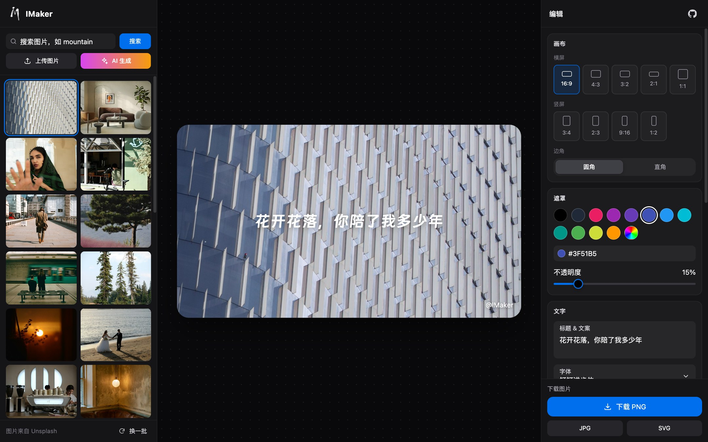
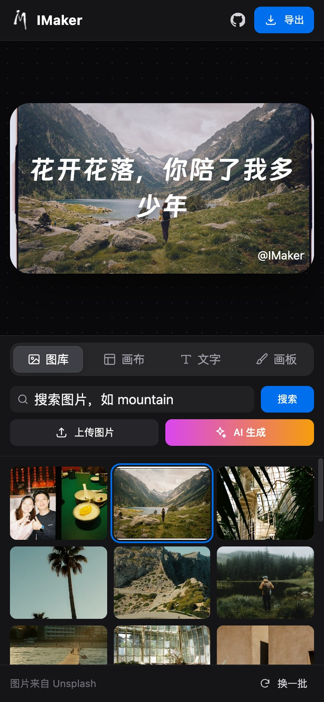

<p align="center">
  
  <br/>
  <br/>
  <a href="https://hellogithub.com/repository/cf52924cf0fb43ea9af96aea4e7a594a" target="_blank"></a>
</p>
<h1 align="center"> IMaker </h1>
<a href="/READMECN.md">中文</a>

## Intro

IMaker is a cover design tool for blogs, videos, WeChat public accounts, and more. It supports desktop and mobile layouts.

## Preview

### Desktop

Three-panel layout: image gallery on the left, a canvas that scales to fit the window in the middle, and the editing panel on the right.



### Mobile

The canvas stays pinned at the top while you switch between the Gallery / Canvas / Text / Draw tabs below, so you can see every change as you make it. Drawing and the export area support touch.

<p align="center">
  
</p>

## Features

- Search Unsplash images, upload local images, or generate images with AI
- Landscape and portrait aspect ratios, rounded or square corners, color overlay with adjustable opacity
- Title text with custom fonts and font size, plus an author watermark in 5 positions
- Freehand drawing with pen and eraser, undo (⌘ / Ctrl + Z) and clear
- Export as PNG / JPG / SVG, or export only a selected area
- Responsive layout for desktop and mobile

## Deployment

Use Node.js 26 (see `.nvmrc`), then clone the repository and install dependencies:

```bash
git clone https://github.com/slince-zero/IMaker.git
cd IMaker
npm ci
```

Create a `.env.local` file and add your API keys:

    VITE_PUBLIC_UNSPLASH_API_KEY = your_unsplash_api_key

[https://unsplash.com/documentation](https://unsplash.com/documentation)

    VITE_PUBLIC_HUGGINGFACE_API_KEY = your_huggingface_api_key

[https://huggingface.co/settings/tokens](https://huggingface.co/settings/tokens)

Start the development server with `npm run dev`.

Open http://localhost:5173 to see the effect.

## New Features

- Generate image by AI 🔥

## Contributing

If you have any suggestions or feedback, please feel free to contribute to the project.

1. Fork the repository
2. Create a new branch (e.g. `feature/new-feature`)
3. Make your changes and commit them (e.g. `git commit -m "Add new feature"`)
4. Push to the branch (e.g. `git push origin feature/new-feature`)
5. Create a pull request

## License

GNU AFFERO GENERAL PUBLIC LICENSE Version 3, 19 November 2007
