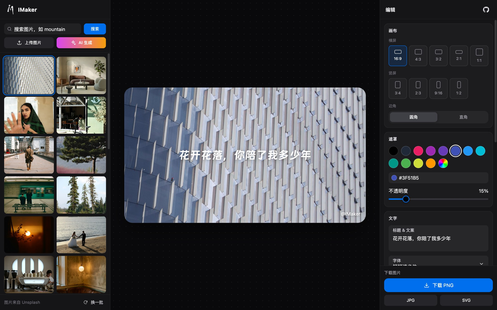
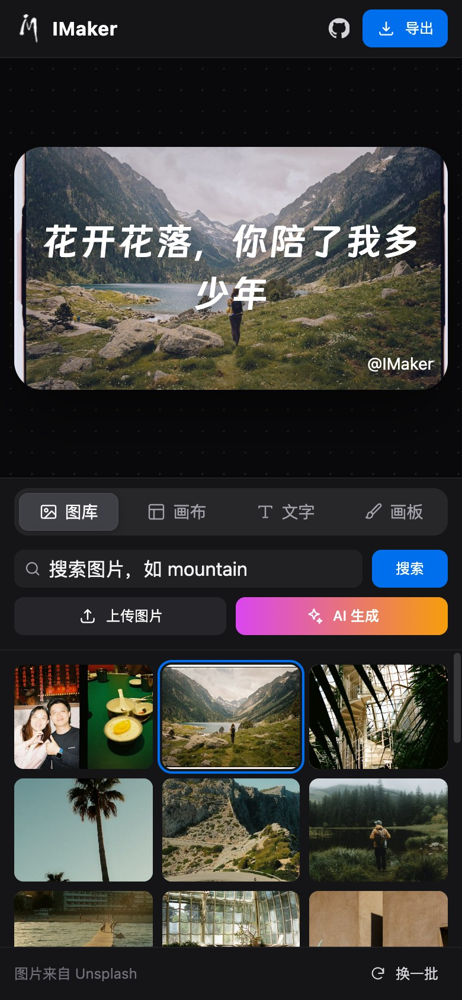
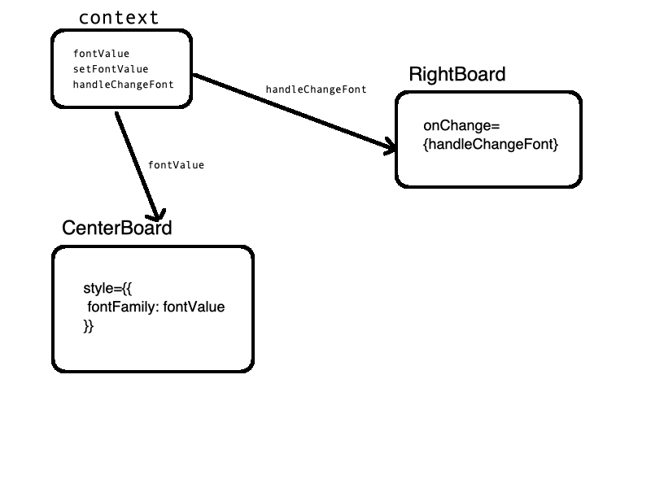

<p align="center">
  
</p>
<h1 align="center"> IMaker </h1>

## 介绍

IMaker 是一款封面设计工具，可以为博客、视频、公众号等设计封面，支持桌面端和移动端布局。

## 预览

### 桌面端

三栏布局：左侧图库，中间画布随窗口自动缩放，右侧编辑面板。



### 移动端

画布固定在顶部，下方通过「图库 / 画布 / 文字 / 画板」页签切换，编辑时随时能看到效果；涂鸦和导出选区都支持触屏。

<p align="center">
  
</p>

## 功能

- 搜索 Unsplash 图片、上传本地图片，或用 AI 生成图片
- 横屏 / 竖屏多种比例，圆角或直角，可调透明度的颜色遮罩
- 标题文案支持切换字体和字号，可放在顶部 / 居中 / 底部，左 / 中 / 右对齐；作者水印支持 5 个位置
- 换比例后可以拖动背景图（或用滑块）选择保留的区域
- 画笔 / 橡皮手写涂鸦，支持撤销（⌘ / Ctrl + Z）和清空
- 导出 PNG / JPG / SVG，也可以只导出选中的区域；文件名会带上搜索关键词，如 `IMAKER-mountain-20261125-111900.png`
- 适配桌面端和移动端

## 部署

使用 Node.js 26（参见 `.nvmrc`），克隆项目并安装依赖：

```bash
git clone https://github.com/slince-zero/IMaker.git
cd IMaker
npm ci
```

创建 `.env.local` 文件并添加 API 密钥：

    VITE_PUBLIC_UNSPLASH_API_KEY = your_unsplash_api_key

[https://unsplash.com/documentation](https://unsplash.com/documentation)

    VITE_PUBLIC_HUGGINGFACE_API_KEY = your_huggingface_api_key

[https://huggingface.co/settings/tokens](https://huggingface.co/settings/tokens)

运行 `npm run dev` 启动开发服务器。

打开 http://localhost:5173 查看效果

## 感谢以下开源项目

https://github.com/gezhaoyou/picprose

## 新特性

- 通过 AI 生成图片 🔥

## 贡献

如果你有任何建议或反馈，请随时贡献。

1. FORK 仓库
2. 创建一个新的分支 (e.g. `feature/new-feature`)
3. 做出你的改变并提交 (e.g. `git commit -m "Add new feature"`)
4. 推送到分支 (e.g. `git push origin feature/new-feature`)
5. 创建一个 pull request

## 协议

GNU AFFERO GENERAL PUBLIC LICENSE Version 3, 19 November 2007

## 遇到的一些问题

### 如果你使用了 verbal 部署你的项目，请一定记得添加环境变量

### useContext 很灵活

通过 createContext 创建一个 contextProvider 就可以在任意组件里面传递数据，而且很灵活，可以直接在跟组件里面用 contextProvider 来包裹根组件。
也可以用它包裹任意你想传递数据的组件当中。

### 上传文件功能中的一些问题

```tsx
<label>
  <input
    type='file'
    onChange={handleUploadImage}
    className='hidden'
  />
  <Button
    variant='flat'
    isIconOnly
    as='span'>
    <UploadLogo />
  </Button>
</label>
```

这里的 `as=span` 是因为有一些默认行为，会影响事件上传功能的执行，所以这里用 `as='span'` 来修复这个问题。我试了一下用 `button` 来代替 `Button`,删除了一个特定的事件监听器之后，文件上传功能可以执行了，不过我忘记是哪个特定的事件了，但是那个事件不是 button 本身的监听器而是其他的，会针对 button。

```tsx
<input
  accept={accept}
  multiple={multiple}
  onChange={fileChange}
  type="file"
  ref={inputRef}
  style={{ display: 'none' }}
></input>
<Button handleClick={uploadClick} style={{ margin: '8px' }} type="primary">
  <UploadOutlined />
  上传
</Button>
```

- 第一种用`<label>`的方式是基于 HTML 标准的行为。标准的 HTML`<label>`元素可以关联到其它字段，当用户点击`<label>`时相当于点击了这些字段，甚至当这些字段不可见时也是这样。

- 第二种是更灵活的 JavaScript 方法。它不依赖于 HTML 的默认行为，而是需要额外的 JavaScript 代码来实现。通常在 uploadClick 函数内部会有一个额外的步骤来手动调用`<input>`元素的点击事件（比如 inputRef.current.click()）。与第一种方法不同的是，这个`<Button>`和`<input>`之间的行为不是通过 HTML 结构来实现的，而是通过 JavaScript 来控制的。

### 添加切换字体

记录一下过程：

1. 添加字体文件到 `src/assets/fonts` 目录下
2. 在 `inedx.css` 中引入（我这里没有使用 tailwind 的导入）
3. 定义 `fontValue` 的 state，和一个用于展示字体值的数组 `font_list`
   context 中传递 `fontValue` 和 `setFontValue` 还有 `handleChangeFont` 用于切换字体的方法

4. RightBoard 中接收 `handleChangeFont`，CenterBoard 中接收 `fontValue`



### 下载功能

1. 定义了一个新的 `ImageDownloadContext`, 并且在其中提供了一个 `imageContainerRef` 和 `handleDownloadImage`
2. 在 `RightBoard` 中接收 `handleDownloadImage`，在 `CenterBoard` 中接收 `imageContainerRef`

### 组件间传递数据，数据类型丢失

`react-konva` 这个库中的 `Line` 组件要求传递的 `strokeWidth，必须为` number 类型

我在 context 中定义了 `penSize`，但是接收过来就成了 `any` 类型，查了一些文档之后，发现组件在传递数据的过程中，会因为多种原因导致数据类型丢失，所以这里就只能显示的定义一个数据类型了

```ts
interface ContextProp {
  boardTool: string
  penSize: number
}
const { boardTool, penSize } = useContext<ContextProp>(ImgContext)
```

### 关于撤销功能

```ts
// 监听键盘事件
const handleKeyDown = (e: KeyboardEvent) => {
  // 判断一下电脑系统
  const userAgent = navigator.userAgent.toLowerCase()

  if (userAgent.indexOf('windows') > -1) {
    // Windows系统
    if (e.ctrlKey && e.key === 'z') {
      // 移除最后一条线并更新状态
      setLines(lines.slice(0, lines.length - 1))
    }
  } else if (userAgent.indexOf('mac') > -1) {
    // Mac系统
    if (e.metaKey && e.key === 'z') {
      // 如果'command'键和'z'键同时被按下，移除最后一条线并更新状态
      setLines(lines.slice(0, lines.length - 1))
    }
  }
}
```

当我将 `if (e.metaKey && e.key === 'z')` 改为 `if (e.key === 'command' || e.key === 'z')` 的时候，摁下 `Command + Z` 也会生效，我自己测试是这个键同时按下第二个代码才会生效，就很奇怪，这似乎违反了它的逻辑？？

### 鼠标指针样式问题

一开始我以为是路径问题，发现控制台的网络请求可以正确看到指针的图片，最后发现是图片大小的问题。
在 Chrome、Firefox 和 Safari 中，自定义光标图像的最大高度和宽度都为 32px。如果你的图像超过这个限制，那么它只会显示为默认的光标。

## 调用 AI 生成图片 API 遇到的问题

我用的是 hugging face 上的 [stable-diffusion-xl-base-1.0](https://huggingface.co/stabilityai/stable-diffusion-xl-base-1.0?text=1+girl)

下面是 API 的使用

```js
async function query(data) {
  const response = await fetch(
    'https://api-inference.huggingface.co/models/stabilityai/stable-diffusion-xl-base-1.0',
    {
      headers: { Authorization: 'Bearer {API_TOKEN}' },
      method: 'POST',
      body: JSON.stringify(data),
    }
  )
  const result = await response.blob()
  return result
}
query({ inputs: 'Astronaut riding a horse' }).then((response) => {
  // Use image
})
```

可以看到，API 返回的是一个 `blob` 对象，需要转换成 url 才能使用，因此我使用了 `createObjectURL` 来转换成 url, 但是这里有一个问题，就是这个数据是临时存在的，如果刷新页面，或者关闭，或者跳转页面，就会消失，因为我是只有一个页面，所以不存在这个问题；但我还是将其移动到了 `Context` 状态管理当中，这样就不会出现这个问题了。

## 关于为什么 leftBoard 组件中为什么不请求更多的图片，比如往下滑动加载图片

主要是一个原因：每次加载就会请求 API，但是 unsplash 做了限制，每小时只能请求 50 次，所以这样去监听滚动事件，很快次数就会用光

疑问：是否有其他的解决方案。

我开始实现这个向下滚动实现加载更多图片的时候，考虑的是，我每次滑倒底部，监听滑动事件，触发一次请求 API，这样子就可以实现展示其他的图片。
这里有一个 bug，是 NextUI 的，因为我用了它的 ScrollShadow 组件，滚动的时候会有阴影效果，它这个会影响我写的监听滚动事件。
